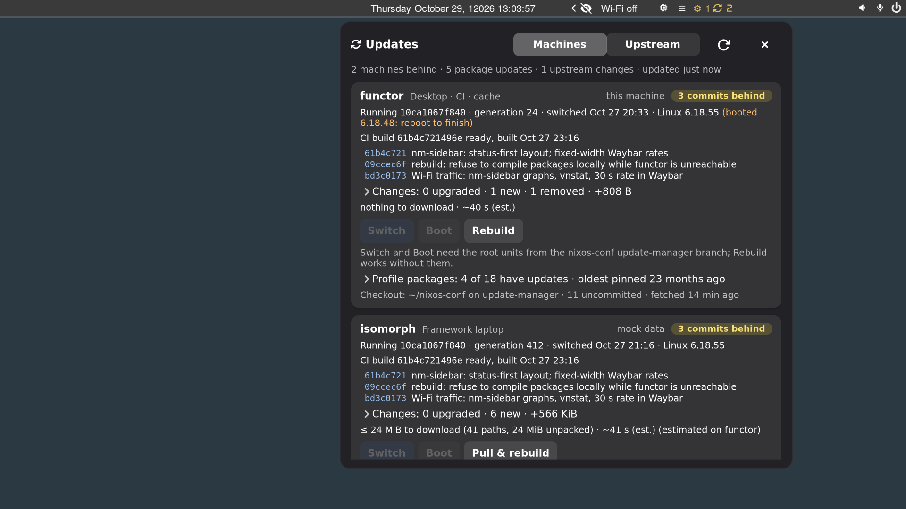

# update-manager

Update status for a small fleet of NixOS machines, in a Waybar widget: which
machine runs an older system than CI has built, what a switch would change,
download and take, nixos-ci's progress and ETA, profile packages with updates,
and forks and patches whose upstream moved. Click to switch, rebuild, build,
upgrade, merge, or hand a conflicting merge to an agent, on any of the machines.

It grew on two machines: **functor** (desktop: nixos-ci, binary cache, remote
builder) and **isomorph** (Framework laptop, niri + Waybar). The defaults in
`src/update_manager/config.py` describe them.



## How it fits together

```
isomorph                                     functor
────────                                     ───────
Waybar ─ update-manager waybar ─┐            update-manager-agent (user)
panel (resident, D-Bus) ────────┤ read          nixos-ci status/journal/progress.json
                                ▼               closure diffs, profiles, forks, patches
          $XDG_RUNTIME_DIR/update-manager/state.json
                                ▲               ~/.cache/update-manager/peers/isomorph.json
update-manager-agent (user) ────┘                         ▲
   every 30 s: ssh functor update-manager exchange ───────┘  (its state up, functor's state
                                                             and queued requests down)
root: update-manager-switch@<system>.service / -boot@  (polkit: the listed users may start them)
```

- **Fast start, as drainhound does it.** A background agent does every slow
  thing (ssh, Nix, git, network) and publishes one small JSON file. The Waybar
  module (`update-manager waybar`) and the panel only read it. The Waybar module
  imports neither GTK nor anything slow. The panel stays loaded and hidden
  (`update-manager-panel.service`, `Type=dbus`) and is toggled over D-Bus
  (`org.gtk.Actions`), so it opens in about 0.1 s. A copy of the state in
  `~/.cache/update-manager` survives reboots, so the widget has something to
  show at login before the agent's first round.
- **No inbound connections to the laptop.** isomorph has no sshd. Its agent
  pushes its own state to functor on every pull, and picks up actions queued
  for it there. Remote actions on functor go over ssh. Actions for isomorph
  started on functor wait in functor's outbox until isomorph next checks in.
- **A fixed action menu.** Remotely you can only ask for `switch`, `boot`,
  `rebuild`, `ci-run`, `ci-update`, `ci-stop`, `ci-apply-lock`,
  `profile-upgrade`, `fork-check`, `fork-apply`, `fork-push`, `fork-agent`,
  `patch-check`, `patch-agent` and `refresh`, with validated arguments
  (`update-manager actions`). Each runs as a job: a transient user unit
  (`systemd-run --user`) that records its state, log and Nix progress in
  `~/.local/state/update-manager/jobs`.

## What it shows

**Machines.** For each machine:
- the system it runs (commit, generation, kernel, and a reboot that's pending);
- nixos-ci's newest build for it and the commits in between;
- a closure diff, like `nix store diff-closures` (upgraded, new and removed
  packages, size change, kernel change);
- the download from `nix-store --realise --dry-run` with functor's cache (on
  another machine's behalf: closure minus what it has, an upper bound);
- a time estimate from measured download rates and activation times;
- its profile packages (`nix profile list`) with updates and upgrade sizes, and
  Z3 Code releases;
- its nixos-conf checkout (ahead, behind, uncommitted);
- the last job.

Only a machine whose commit CI's build descends from is *behind*. A system
from an uncommitted tree, a commit CI's build doesn't contain, or an unknown
commit is a *local build*; a newer commit is *ahead of CI*. Neither gets a
Switch button, since switching to CI's build would drop its changes.
`system.configurationRevision` (`self.rev or self.dirtyRev`) lets the agent
tell these apart for systems nixos-ci didn't build.

**nixos-ci** (functor): the last result per host, the next poll, a typical run
time from the journal, recent runs, flake input ages (↑: the input's branch has
moved upstream). While it builds: builds done/expected, what is building and
for how long, and an ETA. The ETA comes from `update-manager nixlog`, which
nixos-ci pipes Nix's `--log-format internal-json` through (nixos-conf's
`update-manager` branch). It records each derivation's build time in
`/var/lib/nixos-ci/build-times.json`; later ETAs use those times, by name and
then by package across versions. Without that hook the ETA is "typical run
minus elapsed".

**Upstream** (on functor, which has the repositories). For each fork:
`git fetch` the upstream, then follow either the newest stable tag (Z3 Code:
`v[0-9]*.[0-9]*.[0-9]*`, no `-nightly`) or a branch. It counts the fork's own
commits and the new upstream ones, and previews the update without touching a
worktree:
- fast-forward;
- `git merge-tree --write-tree` (clean, or which files conflict);
- for patch stacks, `git replay` onto the new tag. On git 2.52+ `git replay`
  moves refs itself unless given `--ref-action=print`; the preview passes it.

Patched packages in nixos-conf (vicinae, waybar, swaync) get their locked
version compared with nixpkgs-unstable's.

## Clicking

| Button | What runs |
| --- | --- |
| Switch / Boot | `systemctl start update-manager-{switch,boot}@<system>.service` (polkit). As root, `helper/update-manager-switch`: only `<hash>-nixos-system-<this host>-*`, `nix-store --realise` it (signatures checked; functor's cache as an extra substituter), `nix-env --profile …/system --set`, `switch-to-configuration` in its own transient unit, as nixos-rebuild does. Progress, result and timings in `/run/update-manager`, `/var/lib/update-manager`. |
| Rebuild / Pull & rebuild | `git pull --ff-only` in the checkout if it is behind and clean, then the existing passwordless `sudo rebuild`. Works without the root units. |
| Build now / with updated inputs / Stop | `nixos-ci.service`, `nixos-ci-update.service` (wheel may start them already). |
| Commit updated lock | copies nixos-ci's `update.flake.lock` into the checkout and commits it (no push). |
| Upgrade | `nix profile upgrade NAME` (or `--all`). |
| Fast-forward / Merge / Rebase | only when the preview is clean. If the branch isn't checked out: the new commit is made from the preview and the branch moved with compare-and-swap (`git update-ref new old`). If it's checked out: `git merge`/`rebase` in that worktree, and only when the worktree is clean. Never pushes. |
| Push | `git push` (`--force-with-lease` after a rebase) to the fork's `push` remote; off for forks whose origin isn't yours. |
| Ask agent | conflicts: a T3 Code thread on functor, in the repository's T3 project (found by its workspaceRoot, registered if missing), titled like “Merge upstream into nm-sidebar (11 conflicts)”. Its brief has the agent merge in `git worktree add ../<name>-merge -b merge-upstream-<date> <base>`, and never move the checkout's HEAD, push, or commit a submodule bump in nixos-conf. The thread starts through `t3 thread start` when the t3 CLI has it (0.1.4+). Otherwise it goes through T3's MCP endpoint, signed in the way T3 signs in outside agents: a `t3 pair` code approves an OAuth (PKCE) client “update-manager on functor”, and its 30-day token is kept 0600 in `~/.local/state/update-manager/t3/` and renewed 2 days early. That works with t3 0.1.0. If neither works, the brief is saved to `~/.local/state/update-manager/briefs/` and a notification says why. The job's result names the thread and its project. |

Buttons that change a system ask once more ("Switch now?") for 4 seconds.

## Security

- Starting the switch units is root-equivalent for the users you list:
  whoever can put a `nixos-system-<host>` path in the store (any trusted Nix
  user, which wheel is here) can then make it the running system. zyansheep
  already has that through the passwordless `sudo rebuild` and trusted-user.
  The rule adds no new privilege, only a narrower and logged path.
- Remote requests ride on ssh (already full shell access) and are limited to
  the menu. The outbox lets functor's user queue menu actions for isomorph, and
  nothing else.
- The agent runs `git status` with `--no-optional-locks`, so it never takes
  `index.lock` in your checkouts. Fetches only move remote-tracking refs (or
  `refs/update-manager/upstream/*` for an upstream given as a URL).

## Commands

```
update-manager waybar | panel [machines|upstream] | agent | status [--json] | refresh
update-manager do ACTION [JSON] | request HOST ACTION [JSON] | actions | job list|log ID
update-manager check forks|patches|profiles|inputs|update | brief FORK | config [KEY]
```

## NixOS

```nix
inputs.update-manager.url = "git+file:///home/zyansheep/Projects/UpdateManager";  # until it has a remote
inputs.update-manager.inputs.nixpkgs.follows = "latest";

imports = [ inputs.update-manager.nixosModules.default ];
services.update-manager = {
  enable = true;
  users = [ "zyansheep" ];                              # may start the switch units (polkit)
  substituters = [ "http://100.64.0.4:5000?priority=50" ];  # where CI builds are (else: settings.cache_url)
  settings = { };                                       # /etc/update-manager/config.toml
};
```

The module installs the package and the user units `update-manager-agent`
(`default.target`) and `update-manager-panel` (`graphical-session.target`,
`Type=dbus`). It also adds the root template units and the polkit rule.
switch-to-configuration starts no new user units and restarts no changed ones,
so a user activation script restarts both units whenever the package changed
(or the agent isn't running). The panel uses GTK's GL renderer
(`GSK_RENDERER=gl`, `GDK_DISABLE=vulkan`; your own values win). From a user
unit, GTK's Vulkan probe finds no GPU and only logs about it. The
Waybar snippet and its CSS are in [contrib/waybar](contrib/waybar).
`contrib/waybar/updates.sh` finds `update-manager` in the system or the user
profile.

## Configuration

`/etc/update-manager/config.toml`, then `~/.config/update-manager/config.toml`;
every key is optional (`update-manager config` prints what is in effect). The
ones you are likely to change: `hosts.<name>.{ssh,pull,label}`, `ci_host`,
`cache_url`, `forks` (a list: `name`, `repo`, `branch`, `upstream`,
`track = "tag"|"branch"`, `tags`, `exclude`, `upstream_branch`,
`strategy = "merge"|"rebase"`, `push`, `fetch`, `notes` for the agent brief),
`patches`, `releases`, `intervals`, `panel.{width,height,margin_right}`, and
`agent.{enabled,t3,server,model_selection}` (the T3 thread's model; default
Claude Opus 5.5 at xhigh effort, `{"instanceId": "claudeAgent", "model":
"claude-opus-5-5", "options": [...]}`), and a fork's `project` (the T3
project title if it has to be registered).

## Files

| Where | What |
| --- | --- |
| `$XDG_RUNTIME_DIR/update-manager/state.json` | the view: every machine, CI, forks, summary (the widget reads only this) |
| `~/.cache/update-manager/` | the kept view, peers' pushed states, slow-check caches (forks, patches, profiles, inputs, update diff) |
| `~/.local/state/update-manager/` | jobs (`.json` + `.log`), the outbox, agent briefs |
| `/run/update-manager/<hash>.json`, `.result.json` | a switch's progress and outcome (root) |
| `/var/lib/update-manager/history.json` | past switches: bytes, download and activation seconds (for estimates) |
| `/var/lib/nixos-ci/progress.json`, `build-times.json` | nixos-ci's progress and per-derivation build times |

## Development

```sh
nix develop
python -m unittest discover -s tests -t .   # also runs in the package build
bash tests/test-helper.sh                   # the root helper against fake nix-store/nix-env/systemd-run
nix flake check
```

Headless GUI testing (how the screenshots were made): headless sway (output
1920x1080 at scale 1.6, like isomorph), isomorph's patched Waybar with the real
config, the agent with `--mock-peer isomorph`, and the panel with
`UPDATE_MANAGER_PANEL_DEBUG=1`. That adds `debug-click LABEL` and
`debug-scroll FRACTION` D-Bus actions, because a headless seat has no pointer.
`UPDATE_MANAGER_PANEL_EXPAND=1` opens every expander.
